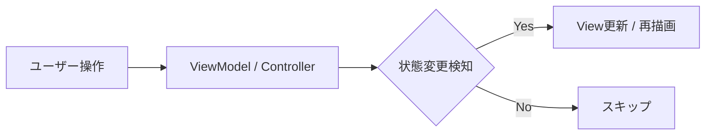

# プレゼンテーションタイトル

## サブタイトルやテーマをここに記述

<div class="pt-12 text-sm opacity-60 flex justify-center items-center gap-6">
  <span>👤 発表者名</span>
  <span>📅 2026-10-10</span>
  <span>🐙 @username</span>
</div>

<!--
【スピーカーノート】
本日は「プレゼンテーションタイトル」について発表します。よろしくお願いします。
-->

---
layout: default
---

# 自己紹介

<div class="grid grid-cols-3 gap-8 mt-8">
  <div class="col-span-1 flex flex-col items-center justify-center p-6 card text-center">
    <div class="w-24 h-24 rounded-full bg-slate-700 flex items-center justify-center text-4xl mb-4">
      👤
    </div>
    <div class="text-xl font-bold">お名前 / Handle</div>
    <div class="text-sm opacity-60 mt-1">所属 / 役職</div>
  </div>

  <div class="col-span-2 flex flex-col justify-center space-y-4">
    <div>
      <div class="font-bold text-emerald-400 mb-1">経歴・バックグラウンド</div>
      <p class="text-sm opacity-80">普段はフロントエンド・バックエンド・ゲーム開発やアーキテクチャ設計に携わっています。</p>
    </div>
    <div>
      <div class="font-bold text-emerald-400 mb-1">得意分野・関心のある技術</div>
      <p class="text-sm opacity-80">TypeScript, Vue, React, Unity, ソフトウェアアーキテクチャ, 自動化</p>
    </div>
    <div>
      <div class="font-bold text-emerald-400 mb-1">リンク・発信媒体</div>
      <p class="text-sm opacity-80">
        GitHub: <a href="https://github.com" target="_blank">@username</a> / 
        X (Twitter): <a href="https://x.com" target="_blank">@username</a> / 
        Blog: <a href="https://zenn.dev" target="_blank">Zenn / Qiita</a>
      </p>
    </div>
  </div>
</div>

<!--
【スピーカーノート】
簡単に自己紹介をさせていただきます。...
-->

---
layout: default
---

# 本日のアジェンダ

<div class="grid grid-cols-2 gap-6 mt-8">
  <div class="card">
    <div class="text-emerald-400 font-bold text-lg mb-2">01. 背景と課題</div>
    <p class="text-sm opacity-75">なぜこのテーマが必要なのか、現状どのような問題が生じているかを整理します。</p>
  </div>
  <div class="card">
    <div class="text-blue-400 font-bold text-lg mb-2">02. 提案アプローチ</div>
    <p class="text-sm opacity-75">課題に対する解決策のコアコンセプトと、全体アーキテクチャを提示します。</p>
  </div>
  <div class="card">
    <div class="text-purple-400 font-bold text-lg mb-2">03. 具体的な実装・検証</div>
    <p class="text-sm opacity-75">コード例や実際のユースケースを交えて挙動と成果を確認します。</p>
  </div>
  <div class="card">
    <div class="text-amber-400 font-bold text-lg mb-2">04. まとめと今後の展望</div>
    <p class="text-sm opacity-75">本日の要点と、今後の改善ポイントを総括します。</p>
  </div>
</div>

<!--
【スピーカーノート】
本日はこの4つのアジェンダに沿って進めていきます。
-->

---
layout: center
class: text-center
---

# 01. 背景と課題

<div class="opacity-60 text-lg mt-2">現状の課題と、なぜ今解決すべきなのか</div>

<!--
【スピーカーノート】
まずは最初のセクション、背景と課題についてです。
-->

---
layout: two-cols
---

# 課題の整理

スライドの文章を左側に記述し、右側に画像や補足要素を配置できます。

<br>

- **課題 1**: 状態管理が複雑化しやすい
- **課題 2**: パフォーマンスのボトルネック
- **課題 3**: 運用・保守コストの増大

<br>

<div class="card-warning text-sm">
  <strong>💡 ポイント:</strong><br>
  単に対処療法を行うのではなく、構造的な根本原因を特定することが重要です。
</div>

::right::

<div class="p-4 flex flex-col items-center justify-center h-full">
  <!-- 画像がある場合は public/images/xxx.png に置いて参照 -->
  <div class="w-full h-56 border-2 border-dashed border-slate-600 rounded-xl flex flex-col items-center justify-center text-slate-400">
    <span class="text-4xl mb-2">🖼️</span>
    <span>画像または図表スペース</span>
    <span class="text-xs text-slate-500 mt-1">public/images/sample.png</span>
  </div>
</div>

<!--
【スピーカーノート】
課題を3点に整理しました。...
-->

---
layout: default
---

# コード解説の例

コードブロックと行ハイライト・ステップ実行を活用できます。

```typescript {all|2|4-6|all}
// 1. 設定インターフェース
interface PresentationConfig {
  title: string;
  theme: 'default' | 'seriph';
  author: string;
}

// 2. 状態初期化処理
export function initializeSlide(config: PresentationConfig) {
  console.log(`Loading presentation: ${config.title}`);
}
```

<v-clicks>

- クリックごとに着目行が切り替わります（`{all|2|4-6|all}`）
- `<v-clicks>` タグで囲むと、クリック順に箇条書きを表示できます
- Shiki による高速で正確なシンタックスハイライトが効きます

</v-clicks>

<!--
【スピーカーノート】
コードの解説です。行ごとのステップ表示で聴講者の視線を誘導できます。
-->

---
layout: default
---

# ダイアグラム（Mermaid）

Slidev では Markdown 内で直接 Mermaid ダイアグラムを描画できます。



<br>

<div class="grid grid-cols-3 gap-4 text-center mt-4">
  <div class="card">
    <div class="font-bold text-emerald-400">① 操作入力</div>
    <div class="text-xs opacity-60 mt-1">イベントの発火</div>
  </div>
  <div class="card">
    <div class="text-blue-400">② ロジック処理</div>
    <div class="text-xs opacity-60 mt-1">状態の同期</div>
  </div>
  <div class="card">
    <div class="text-purple-400">③ レンダリング</div>
    <div class="text-xs opacity-60 mt-1">UIへの投影</div>
  </div>
</div>

<!--
【スピーカーノート】
全体の処理フローを図解したものです。
-->

---
layout: default
---

# まとめ（Key Takeaways）

<div class="space-y-4 mt-6">
  <div class="card-highlight flex items-start gap-4">
    <div class="text-2xl text-emerald-400">✅</div>
    <div>
      <div class="font-bold text-emerald-300">要点 1: 構造の明確化</div>
      <div class="text-sm opacity-80 mt-1">責務を分離することで、変更に強い保守性の高い設計を実現できる。</div>
    </div>
  </div>

  <div class="card-highlight flex items-start gap-4">
    <div class="text-2xl text-emerald-400">✅</div>
    <div>
      <div class="font-bold text-emerald-300">要点 2: 適切なツールの選定</div>
      <div class="text-sm opacity-80 mt-1">ユースケースに合った技術・ライブラリを選ぶことが成功の鍵。</div>
    </div>
  </div>

  <div class="card-highlight flex items-start gap-4">
    <div class="text-2xl text-emerald-400">✅</div>
    <div>
      <div class="font-bold text-emerald-300">要点 3: 段階的な導入</div>
      <div class="text-sm opacity-80 mt-1">小さなスコープから検証し、徐々に全体へ適用していく。</div>
    </div>
  </div>
</div>

<!--
【スピーカーノート】
本日のまとめです。この3つの要点をお持ち帰りいただければ幸いです。
-->

---
layout: center
class: text-center
---

# Thank you!

ご清聴ありがとうございました

<div class="pt-8 flex justify-center gap-8 text-sm opacity-80">
  <a href="https://github.com" target="_blank">GitHub</a>
  <a href="https://x.com" target="_blank">X (Twitter)</a>
</div>

<div class="pt-6 text-xs opacity-40">
  質疑応答 / Q&A
</div>

<!--
【スピーカーノート】
発表は以上となります。質問やフィードバックがあればぜひお願いします。
-->
